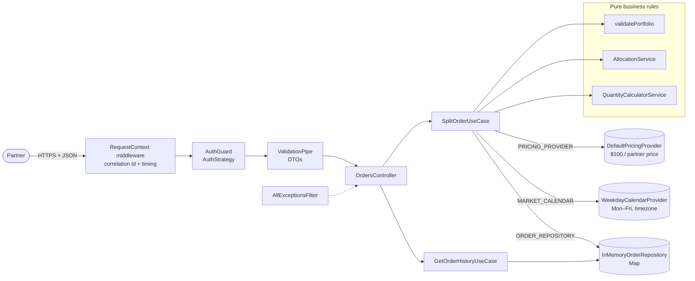
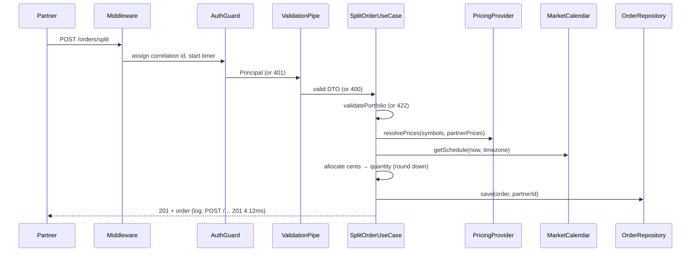
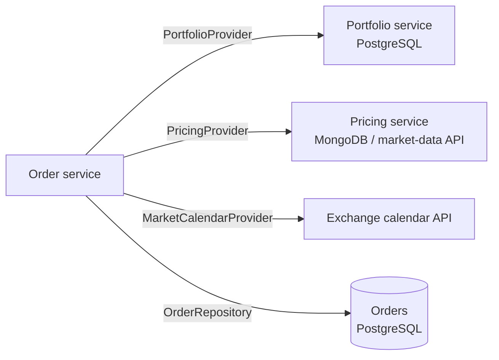
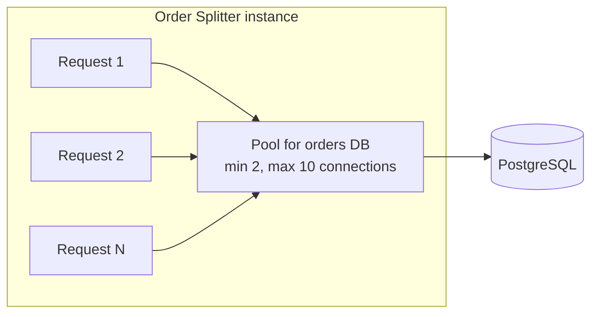
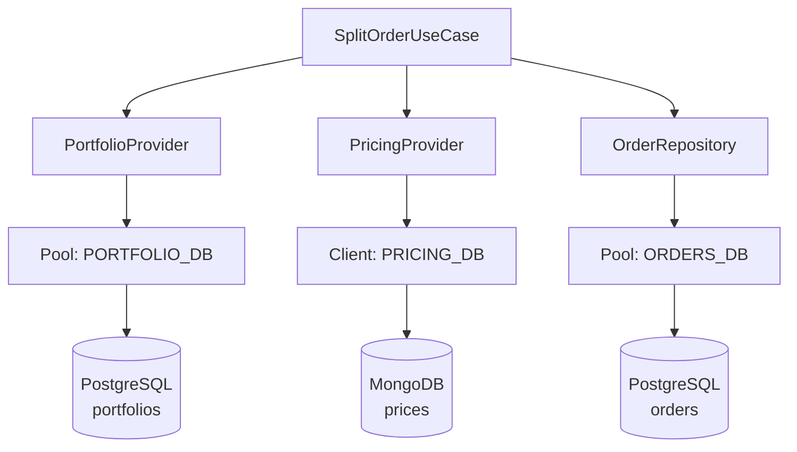
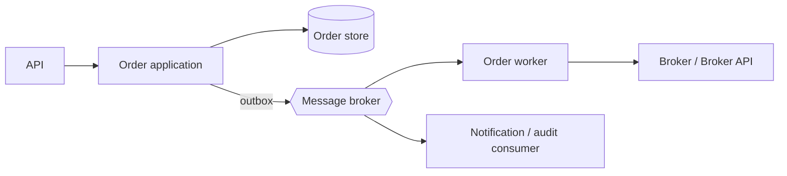

# Architecture

Legend: **[Now]** implemented · **[Future]** recommended, not implemented.

## 1. System overview [Now]

A modular monolith. Business rules are plain TypeScript; infrastructure sits behind four small ports
that are injected through Nest DI tokens.



## 2. Request flow — `POST /api/v1/orders/split` [Now]



## 3. Module responsibilities

| Module | Responsibility | Knows about |
|---|---|---|
| `orders/domain` | Portfolio rules, allocation, quantity maths, `Order` type, repository contract | only `decimal.js` |
| `orders/application` | Orchestrates one use case; no HTTP, no storage specifics | ports |
| `orders/infrastructure` | `InMemoryOrderRepository` | the Map |
| `orders` controller + DTOs | HTTP shape, validation, Swagger | use cases |
| `pricing` | Resolves a price per symbol | config |
| `market-calendar` | Decides the execution date | `Intl` |
| `auth` | Authenticates the caller, yields a `Principal` | strategy |
| `common` / `config` | Decimal config, clock, error filter, middleware, env validation | – |

## 4. Provider / adapter design

Each port is independent: changing one never changes another or the calculation engine.

| Port (token) | Today | Swap-in examples [Future] |
|---|---|---|
| `PricingProvider` (`PRICING_PROVIDER`) | `DefaultPricingProvider`: partner price else `DEFAULT_PRICE` | `MarketDataPricingProvider` (HTTP feed) or `MongoPricingProvider` |
| `MarketCalendarProvider` (`MARKET_CALENDAR`) | `WeekdayCalendarProvider` | `ExchangeCalendarProvider` (holidays, hours, per-exchange tz) |
| `OrderRepository` (`ORDER_REPOSITORY`) | `InMemoryOrderRepository` | `PostgresOrderRepository` |
| `AuthStrategy` (`AUTH_STRATEGY`) | none / api-key / jwt / function | OIDC + JWKS, mTLS |
| *PortfolioProvider* | **not built** – portfolio arrives in the request | `PostgresPortfolioProvider` / HTTP profile service, resolved by a `portfolioId` in the request |

Example of a replacement — only the provider binding changes:

```ts
// orders.module.ts
{ provide: ORDER_REPOSITORY, useClass: PostgresOrderRepository }
// pricing.module.ts
{ provide: PRICING_PROVIDER, useClass: MarketDataPricingProvider }
```

### Independent databases example [Future]



Rules for remote providers: explicit **timeouts**, bounded **retries** with jitter, **circuit breaker**, fail
the order (never guess a price), cache only where the data tolerates staleness (calendar yes; prices only
with a short TTL and a stale-price policy), propagate `X-Correlation-Id`, and keep each provider on its own
connection/credentials. Because the use case persists only the final order, there is no cross-database
transaction; the order stores the prices and schedule it used so it stays auditable even if sources change.
Partner isolation: every repository call takes `partnerId` (already true today) and the DB enforces it too.

## 4b. Database connections [Orders DB: optional adapter implemented; the rest: Future]

By default the application opens no connection (in-memory history, as the challenge requires). Setting
`STORAGE=postgres` activates an **implemented, optional** adapter for the orders database:
`src/config/database.config.ts`, `src/modules/orders/infrastructure/postgres/` (pool + startup check +
shutdown, `PostgresOrderRepository`, schema) and the selection in `orders.module.ts`. It is tested against
the `pg-mem` emulator only. Portfolio, pricing and calendar databases, read replicas and the rest of this
section remain **future** design. The text below explains the pattern and how it extends to several databases.

### One connection pool per database, created at startup

A connection is expensive to open, so each database gets one **pool** created when the app starts and
shared by every request. A request borrows a connection, runs its query, and returns it.



Steps:
1. **Config**: `DATABASE_URL`, pool size and timeouts are read and validated at startup (same fail-fast
   pattern as `app.config.ts`). Credentials come from a secrets manager, never from the repo.
2. **Connect on startup**: a Nest provider builds the pool (`onModuleInit`) and fails the boot if the
   database is unreachable, so a broken instance never receives traffic.
3. **Use**: the repository receives the pool by injection and runs parameterised queries (no string
   concatenation, to prevent SQL injection).
4. **Health**: `/health` (readiness) runs `SELECT 1`; the load balancer stops routing to an instance whose DB is down.
5. **Shutdown**: `onModuleDestroy` closes the pool after in-flight requests finish (`app.enableShutdownHooks()`).

```ts
// database.config.ts  (illustrative)
export interface DatabaseConfig { url: string; poolMax: number; connectTimeoutMs: number; queryTimeoutMs: number }

// orders-database.module.ts  (illustrative, using `pg`)
export const ORDERS_DB = Symbol('ORDERS_DB');

@Module({
  providers: [
    {
      provide: ORDERS_DB,
      inject: [APP_CONFIG],
      useFactory: async (config: AppConfig) => {
        const pool = new Pool({
          connectionString: config.ordersDb.url,
          max: config.ordersDb.poolMax,
          connectionTimeoutMillis: config.ordersDb.connectTimeoutMs,
          statement_timeout: config.ordersDb.queryTimeoutMs,
        });
        await pool.query('SELECT 1'); // fail fast at startup
        return pool;
      },
    },
  ],
  exports: [ORDERS_DB],
})
export class OrdersDatabaseModule {}

// postgres-order.repository.ts
@Injectable()
export class PostgresOrderRepository implements OrderRepository {
  constructor(@Inject(ORDERS_DB) private readonly db: Pool) {}
  async save(order: Order) {
    await this.db.query('INSERT INTO orders (id, partner_id, payload, created_at) VALUES ($1,$2,$3,$4)',
      [order.id, order.partnerId, order, order.createdAt]);
    return order;
  }
  // findById / findAll filter by partner_id, with an index on (partner_id, created_at DESC)
}
```

A sample of connection settings (one block per database, plus market-data, calendar, cache and broker) is in
[.env.connections.example](../.env.connections.example). Only its `ORDERS_DB_*` block is read by the
application, and only when `STORAGE=postgres`; everything else there is a proposal.

### Using multiple databases at the same time

Yes. Give **each database its own token, its own pool and its own provider**. Nothing is shared, so
changing one never affects another.



```ts
// orders.module.ts (illustrative): each port bound to its own adapter and connection
imports: [PortfolioDatabaseModule, PricingDatabaseModule, OrdersDatabaseModule],
providers: [
  { provide: PORTFOLIO_PROVIDER, useClass: PostgresPortfolioProvider }, // uses PORTFOLIO_DB
  { provide: PRICING_PROVIDER,   useClass: MongoPricingProvider },      // uses PRICING_DB
  { provide: ORDER_REPOSITORY,   useClass: PostgresOrderRepository },   // uses ORDERS_DB
],
```

With an ORM the same idea is a **named connection** (TypeORM `name`/`DataSource` per database,
Mongoose `createConnection`, Prisma one client per schema).

### Rules for several connections

| Topic | Guidance |
|---|---|
| Pool sizing | Per instance: `poolMax × instances` must stay below the database's `max_connections`. Use PgBouncer / RDS Proxy when many instances run |
| Isolation | Separate credentials per database with least privilege (read-only for pricing/portfolio, write for orders) |
| Timeouts | Connect timeout, statement timeout and an overall request budget; a slow dependency must not hold the request open |
| Failure | Retry reads with backoff and a circuit breaker; never guess a missing price or portfolio, reject the order instead |
| Consistency | No distributed transaction: reads happen first, then **one** write to the order store holding the prices and schedule used. Use the outbox pattern if an event must follow the write |
| Reads at scale | Read replica for history queries (`GET /orders`); primary only for writes |
| Partner isolation | Every query filters by `partner_id`; optionally enforce it in the DB with row-level security |
| Observability | Log query time per database, expose pool usage (in-use / waiting) as metrics, propagate `X-Correlation-Id` into query comments |
| Migrations | Versioned migrations (Flyway, Prisma Migrate, TypeORM) run in CI/CD, never automatically at app start in production |
| Tests | Unit tests keep mocking the ports; add integration tests against a throwaway database container (Testcontainers) |

## 5. Decisions

| # | Decision | Why |
|---|---|---|
| 1 | `decimal.js` + string money in JSON | no float drift; exact audit trail |
| 2 | Round quantities **down**; report `unusedAmount` | never over-spend/over-sell; transparent |
| 3 | Largest-remainder cents | allocations always sum to the total, deterministic |
| 4 | Weights must sum to exactly 100 | financial input should not be silently "fixed" |
| 5 | 400 for shape errors, 422 for business rules | clients can tell "malformed" from "valid but not allowed" |
| 6 | Middleware, not interceptor, for timing | also times guard/pipe/filter rejections |
| 7 | Auth optional, default off, but pluggable | brief does not require it; shows extension point without forcing it |
| 8 | No `PortfolioProvider`, no queues | YAGNI — documented instead of coded |
| 9 | NestJS 11 | v12 is ESM-only; no benefit for this scope |
| 10 | Weekday evaluated in a configurable timezone | "Friday night in New York" is Saturday in UTC |

Identifiers: **Order ID** = the stored order (`id`). **Correlation ID** = one request flow in logs
(`X-Correlation-Id`). A separate business-level *tracking ID* is not used, as nothing in the brief needs it.

## 6. Scaling and asynchronous processing [Future]

The current flow is synchronous and CPU-trivial (microseconds of arithmetic); a queue is **not** needed.
Add one only when: orders must go to a broker (long-running, retry-able), several independent consumers
need the same events, or traffic must be buffered.



| | Kafka | RabbitMQ | AWS SQS |
|---|---|---|---|
| Model | Distributed log / event stream | Broker with exchanges & queues | Managed queue |
| Best for | High-throughput events, many independent consumers, retention + **replay**, event-driven integration | Task queues, routing, worker distribution, per-message ack/retry/DLQ | AWS-native decoupling with minimal operations |
| Ordering | Per partition | Per queue | FIFO queues (limited throughput) |
| Retention | Configurable, replayable | Until consumed | Up to 14 days, no replay |
| Ops burden | Highest | Medium | Lowest |

Choose by: throughput, processing duration, delivery guarantees (at-least-once ⇒ idempotent consumers),
ordering, retry/DLQ needs, replay needs, and where you already run infrastructure. For order execution
a typical pick is SQS (on AWS) or RabbitMQ for work queues, and Kafka if the order stream feeds analytics,
risk and reporting consumers. Not implemented: no unused broker interfaces exist in the code.

Other scaling steps: stateless instances behind a load balancer (needs external storage first), connection
pooling, pagination (already present), observability (OpenTelemetry traces, Prometheus metrics, CloudWatch
dashboards), and load testing against a latency SLO.

## 7. Security and reliability — implemented vs recommended

| Control | Status |
|---|---|
| Input validation (types, ranges, unknown-field rejection), 100 kb body limit | **Now** |
| Non-leaky, uniform error responses; startup config validation | **Now** |
| Pluggable auth (API key SHA-256 digests, JWT HS256 pinned), partner isolation | **Now** (optional) |
| Correlation ID, per-request timing logs | **Now** |
| OAuth2/OIDC + JWKS, scopes, mTLS | Future |
| HTTPS/HSTS/helmet, rate limiting, quotas | Future |
| Idempotency keys, audit log, secrets manager | Future |
| Persistent store, migrations, backups | Future |
| Metrics, tracing, alerting, health/readiness probes | Future |
